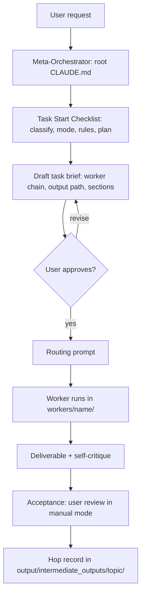

# claude_agents

## Purpose

The harness exists to let an LLM do knowledge work (research briefs, technology and vendor comparisons, presentations, code from library docs) while keeping the output grounded in fetched sources rather than training data. Workers fetch only approved sources, report what could not be fetched, and end each deliverable with a self-critique that lists unsupported claims. The aim is to make ungrounded claims visible, not to prevent them. The operator still decides which sources to trust and whether the output is good enough to use, and remains the main safeguard. These properties are instructions to the model, not enforced checks.

Whether this beats plain Claude, or doing the work by hand, is not yet evidenced. See [`STATUS.md`](STATUS.md) for what is and is not shown.

## What this is

A Claude Code harness. A root `CLAUDE.md` makes the main session a Meta-Orchestrator that classifies a task, drafts a task brief, and routes it to one of five workers (Developer, Architect, Content, Researcher, Scout). The workers are backed by three local MCP servers: `docs_fetcher` (fetch and cache documentation), `system_monitor` (read-only system stats) and `web_search` (Brave Search API, scout only) (`CLAUDE.md`, `servers/`). The rules are plain markdown. A coordinator program and a 5-phase pipeline sit alongside; both are built but not currently used, and are kept for future buildouts (`coordinator/README.md`, `pipeline/PIPELINE.md`).

The repo is a **template**. Runtime state is gitignored: `logs/*` (except templates and the task-log protocol), `kb/`, `sandbox/`, `output/*`, `pipeline/runs/`, `.mcp.json`, `.claude/*`, the docs_fetcher source registries and routing prompts (`.gitignore`). Tracked onboarding files are the `*_TEMPLATE.*` and `*.template.json` files.

## Who it's for

**Human operator.** You describe tasks, approve each task brief, and in manual mode open the worker session yourself. You also review deliverables and each worker's self-critique (`CLAUDE.md` Worker Routing Protocol, `workers/MODE_SELECTION_PROTOCOL.md`).

**Agent.** The Meta-Orchestrator follows the Task Start Checklist in `CLAUDE.md`. A worker follows `workers/WORKER_STANDARDS.md` plus its own `workers/<name>/CLAUDE.md`. The Meta-Orchestrator does not write application code and does not call worker tools. Workers do not write routing prompts for other workers (`CLAUDE.md`, `workers/WORKER_STANDARDS.md` Handoff Rule).

## Fit for purpose

This section is derived from the rules in the tracked files. It is not a claim about observed results (see Evidence and track record). Grounding, sandboxing and staleness limits are instructions to the model, not enforced mechanisms.

### Good fit
- Work where claims must trace to sources. Developer, Architect, Content and Researcher all require deliverables to trace to fetched kb files, and failed fetches must be reported (`workers/WORKER_STANDARDS.md`, `workers/*/CLAUDE.md`).
- Work you want gated by a human. Briefs need explicit approval; destructive or system-level commands need confirmation (`CLAUDE.md`). The pipeline is designed to refuse publishing until `Human Verdict: APPROVED`, but it has not been run (`pipeline/PIPELINE.md`).
- Multi-step features that benefit from file-based phase handoffs and a held-back test spec. This is the pipeline's design; it is unused so far (`pipeline/PIPELINE.md`).
- A reusable rule set you can copy into another repo: the pipeline and `TASTE.md` are described as portable, though the pipeline has not been exercised (`pipeline/PIPELINE.md`, Bootstrapping).

### Not a good fit
- Quick one-off edits. Every task starts with a six-step checklist, and code needs a kb file per import and shell command (<=30 days old) before any code is written (`CLAUDE.md`, `workers/developer/CLAUDE.md`). That is the process-overhead cost.
- Fully unattended runs. Prompt approval, gap acknowledgment and correction-retry gates always pause for a human (`coordinator/README.md`), and coordinator mode is currently disabled (`workers/MODE_SELECTION_PROTOCOL.md`).
- Work that needs unregistered URLs on the fly. Workers may fetch only registered or briefed URLs and must flag others (`workers/WORKER_STANDARDS.md`).
- Anyone who needs results on day one. No outcome data is tracked (see `STATUS.md`).

## How it works

| Worker | Directory | Does | Tools |
|---|---|---|---|
| Developer | `workers/developer/` | Grounded code, sandbox scripts, ML tasks, system checks, technical docs | `docs_fetcher`, `system_monitor` |
| Architect | `workers/architect/` | Technology selection, architecture proposals, tradeoffs; no code | `docs_fetcher` |
| Content | `workers/content/` | Research-grounded written deliverables and document review; no code, no technical docs | `docs_fetcher` |
| Researcher | `workers/researcher/` | Pre-task planning docs, and research reports from owner-approved sources (report mode); no code, no architecture | `docs_fetcher` |
| Scout | `workers/scout/` | Source discovery by web search for owner approval; no fetching, no findings | `web_search` |

**Tools.** `docs_fetcher` has 11 tools (list/add for libraries, CLIs and other sources; `fetch_docs`, `fetch_url`, `search_docs`, `crawl_docs`, `get_fetch_stats`). `system_monitor` has 5 (CPU, memory, disk, directory size, large-file scan). `web_search` has 1 (read-only web search) (`servers/*/server.py`).

**Manual vs coordinator mode.** Manual: the Meta-Orchestrator writes a self-contained routing prompt to `workers/<worker>/routing_prompt_<slug>.md` (gitignored), and you open a Claude Code session in that worker directory and have it read the file. Before the prompt is deleted, a copy goes to `output/intermediate_outputs/<topic>/hop_N_<worker>_<name>.md` with an outcome note (`CLAUDE.md`). Coordinator: `python -m coordinator` runs the chain through the Claude Agent SDK, with automated acceptance checks (file exists, required sections present, self-critique present) and an internal read-only Validator (`coordinator/README.md`, `coordinator/acceptance.py`, `coordinator/worker_registry.py`). A standing override active since 2026-09-28 disables coordinator selection; manual is the active path (`workers/MODE_SELECTION_PROTOCOL.md`).

**Pipeline.** Built but not currently used: no runs exist, and it is kept for future buildouts. For end-to-end feature work, `pipeline/PIPELINE.md` defines five phases (research, planning, coding, validation, publicizing) as standalone files in `pipeline/phases/`. Phases communicate only through artifacts in `pipeline/runs/<task_slug>/`. The test spec is written in planning and withheld from coding, and publicizing is blocked until a human verdict of APPROVED. See [`pipeline/PIPELINE.md`](pipeline/PIPELINE.md).

## Getting started

Setup is derived only from the templates, `servers/*/pyproject.toml` and `CLAUDE.md`. Steps marked (unverified) are inferences from file names or `.gitignore`, not stated instructions.

1. Prerequisites: `uv` on PATH; an authenticated `claude` CLI (`coordinator/README.md`, `CLAUDE.md` Infrastructure Rules). Python >=3.11 for the servers (`servers/*/pyproject.toml`).
2. Copy `.mcp.template.json` to `.mcp.json` and replace `<YOUR_PROJECT_ROOT>` with the absolute repo path. It registers `system_monitor` and `docs_fetcher` over stdio via `uv`. (Target filename `.mcp.json` follows `.gitignore`; unverified.)
3. Copy `.claude/settings.template.json` to `.claude/settings.json` (SessionStart health-check and CLAUDE.md-reminder hooks; replace the same placeholder) and `.claude/settings.local.template.json` to `.claude/settings.local.json` (enables both servers). (Target filenames unverified.)
4. Copy the three `servers/docs_fetcher/*.template.json` files to `libraries.json`, `clis.json`, `other_sources.json` and fill them with the documentation URLs workers may fetch. `WORKER_STANDARDS.md` says these files are gitignored and may be absent, and says to create one as `{}` if missing.
5. Optional runtime logs: the `logs/*TEMPLATE*` files are blank examples of the gitignored logs. (Whether to copy them is unverified; the scripts create their own alert files.)
6. Whether `uv` installs server dependencies automatically on first run, or needs a separate sync, is not stated in tracked files (unverified). `uv.lock` files are present for both servers.
7. Per worker: copy `workers/<worker>/.claude/settings.local.template.json` to `settings.local.json` in the same folder for architect, content, developer, researcher and scout, and replace `<YOUR_PROJECT_ROOT>` with the absolute repo path (the `Read(/<YOUR_PROJECT_ROOT>/**)` entries then start with `//`). Each template enables only the servers that worker is assigned in `CLAUDE.md`. (Target filenames unverified.)
   Scout only (optional): copy `workers/scout/.mcp.template.json` to `workers/scout/.mcp.json`, replace `<YOUR_PROJECT_ROOT>`, and export `BRAVE_SEARCH_API_KEY`. The root `.mcp.template.json` intentionally has no `web_search`. (Key delivery to the server is unverified; no live Brave call has been made.)
8. Start Claude Code at the repo root. The `scripts/check_*.py` checks are described as weekly cron jobs in `CLAUDE.md`; the cron setup itself is not tracked (unverified), so run the scripts by hand if you have not scheduled them. The SessionStart hooks come from `.claude/settings.json` (step 3).

## Current state

Components and what each is (details and maturity signals in [`STATUS.md`](STATUS.md)):
- Meta-Orchestrator rules and protocols: `CLAUDE.md`, `workers/*_PROTOCOL.md`, `workers/WORKER_STANDARDS.md`, `logs/EPHEMERAL_TASK_LOG_PROTOCOL.md`, `servers/TOOL_BUILDING_LOOP.md`.
- Five workers: `workers/{developer,architect,content,researcher,scout}/CLAUDE.md`.
- Three MCP servers with lockfiles: `servers/docs_fetcher/`, `servers/system_monitor/`, `servers/web_search/` (plus two SessionStart hook scripts).
- Research report format: `workers/RESEARCH_REPORT_PROTOCOL.md`.
- Coordinator program (five modules, disabled by standing override): `coordinator/`.
- Pipeline (five phase files and a run-contract checker; unused, kept for future buildouts): `pipeline/`, `scripts/check_pipeline_run.py`.
- Maintenance scripts: KB staleness, server freshness, markdown length (<=100 non-empty lines for rule files), pipeline run check: `scripts/`.
- `TASTE.md`: standing preferences read by pipeline phases.

## Evidence and track record

What the tracked repo can show: the build-out timeline in `git log`, 58 commits from 2026-03-30 (e1ed54c) to 2026-10-14 (528b48c).
- 2026-03-30 to 2026-04-06: initial structure with the `docs_fetcher` server, then `system_monitor` and the CLI/other-sources registries (4497270, 0b92a2f, b4c1a4b, per commit messages).
- 2026-05-11 to 2026-05-15: worker standards extracted into a shared file (3da531f), a template-only branch initialized (20ea7aa), and runtime logs untracked (4f3e92a, c44b26f), all per commit messages.
- 2026-06-16 to 2026-06-29: bug-fix, documentation and context-intake protocols (00c0e53); Agent SDK coordinator and two-mode architecture (084eb28, 6d8df9f), per commit messages.
- 2026-07-08 to 2026-07-23: five-phase pipeline, taste config and run checker (beea21f, 71b9b42, 1f48d9b), per commit messages.
- 2026-08-28 to 2026-09-28: ephemeral task log (70781a8), human-retrieved-sources protocol (3d96d6b), coordinator mode disabled and manual-mode handoff archiving required (aa8e3e6), `docs_fetcher` fixes (5247a95), per commit messages.
- 2026-10-06 to 2026-10-14: README and STATUS added (e5e73fc), read-only annotations on MCP tools (8aee2eb), track-record fields and owner-triggered archive protocol (1ded804, 528b48c), per commit messages.

What it cannot show: the history includes a commit titled "Archive full working state: outputs, all kb files, and sandbox scripts" (306bf88), later followed by a template-only reset (20ea7aa), but the current tracked tree contains no outputs, logs, kb files or run artifacts. No task outcomes, success rates, or cost/time per task are evidenced in tracked files. Nothing here should be read as a claim that the harness works well on real tasks; see "Not yet evidenced" in [`STATUS.md`](STATUS.md).

## Design rationale

### Why an orchestrator with specialized workers

The root `CLAUDE.md` gives the main session one job: classify, route and build infrastructure. It does not write application code, architecture proposals or research deliverables (`CLAUDE.md`, Role). Each worker has one mandate and a short rule file: Developer for code and technical docs, Architect for technology selection with no code, Content for written deliverables, Researcher for pre-task planning and research reports, Scout for source discovery (`workers/*/CLAUDE.md`). The routing rules also fix who owns ambiguous work, for example technical docs go to Developer and Content must refuse them (`CLAUDE.md` Task Start Checklist; `workers/content/CLAUDE.md`; 79fe7c6).

What the split buys:
- **Narrow tool surface.** Only Developer gets `system_monitor`; only Scout gets `web_search`; the other three get `docs_fetcher` only (`CLAUDE.md` Workers table; `coordinator/worker_registry.py`, `_WORKER_MCP_NAMES`). The building loop says to "err toward fewer tools" (`workers/WORKER_BUILDING_LOOP.md`, step 3).
- **Scoped writes (by instruction).** Each worker is instructed to write only to its own `kb/`, `human-retrieved-sources/` and `../../output/`; Developer also has `sandbox/` (`workers/WORKER_STANDARDS.md` item 5). The coordinator runs each worker with its own directory as `cwd` so that worker's `CLAUDE.md` loads (`coordinator/README.md`, CLAUDE.md loading).
- **One place for shared rules.** Common rules live in `workers/WORKER_STANDARDS.md`; worker files hold only mandate-specific content. Commit 3da531f describes this refactor, and `workers/WORKER_GAP_PROTOCOL.md` routes fixes to the shared file first.
- **No cross-worker prompt writing.** Workers state the next hand-off and stop; only the orchestrator drafts routing prompts (`workers/WORKER_STANDARDS.md`, Handoff Rule). Inferred from that rule: this keeps classification and the audit trail in one place.

The sandbox is a rule, not a mechanism. The coordinator gives workers `Write` with `permission_mode="acceptEdits"` (`coordinator/worker_registry.py`); the directory limits come from `cwd` and the worker's `CLAUDE.md` text.

### Why human gates

The gates sit where an error is expensive or hard to see:
- **Brief approval.** The orchestrator drafts the brief and waits for explicit approval before giving the run command (`CLAUDE.md`, Worker Routing Protocol). Workers cannot ask mid-task, so the brief must be complete but carry only the task-specific delta (`CLAUDE.md`, Routing Prompt Quality Standard; full rules in `workers/ROUTING_PROMPT_PROTOCOL.md`).
- **URL approval up front.** Workers fetch only registered or briefed URLs and flag the rest instead of fetching (`workers/WORKER_STANDARDS.md` item 1). Approval happens before the task, not during it (items 1 and 6). Inferred from `workers/WORKER_STANDARDS.md`: this bounds what external content reaches a deliverable.
- **Failed fetch stops the task.** A failed or thin fetch must be reported and the worker asks how to proceed; there is no silent fall back to training data (item 2). When the user supplies a replacement, the substitution is disclosed (Human-Retrieved Source Protocol; 3d96d6b).
- **Acceptance and gaps.** The coordinator checks file existence, required sections and a self-critique, and every reported gap pauses for acknowledgment with no severity filter (`coordinator/README.md`, Q3; `coordinator/acceptance.py`). The README gives the reason: surface worker judgment to the human rather than make editorial calls.
- **Destructive and outward-facing actions.** Confirm before delete, format or system-level commands (`CLAUDE.md`, Security); `TASTE.md` extends this to push, PR and publish. The pipeline will not publish until `validation_report.md` records `Human Verdict: APPROVED` (`pipeline/PIPELINE.md`), and `scripts/check_pipeline_run.py` can verify that gate.

### Why two modes (manual and coordinator)

`workers/MODE_SELECTION_PROTOCOL.md` assigns tasks by whether they can run unattended. Coordinator mode fits a complete spec, a defined output format, no mid-task clarification and pre-approvable URLs. Manual mode fits bug fixes, exploratory or iterative work, context-dependent work and unknown URLs, where the user must steer mid-task. The history shows the coordinator was built on the Agent SDK (084eb28) and the two-mode split came in 6d8df9f.

Coordinator mode is currently disabled. A standing override, "active since 2026-09-28", says to always recommend manual mode and leaves `coordinator/` in the repo, uninvoked (`workers/MODE_SELECTION_PROTOCOL.md`). Commit aa8e3e6 pairs it with a requirement to archive manual-mode hand-offs (per its message), and `CLAUDE.md` now requires a copy of each consumed routing prompt in `output/intermediate_outputs/`. The repo gives no reason for the override. Inferred from `workers/MODE_SELECTION_PROTOCOL.md` and `CLAUDE.md`: manual mode was preferred for control and visibility, and the archive rule replaces the logging the coordinator did automatically.

### Why template-plus-local-state

The tracked repo holds rules, code and blank templates. Runtime state is gitignored: `kb/`, `sandbox/`, `output/*`, `logs/*`, `.mcp.json`, `.claude/*`, `pipeline/runs/`, the docs_fetcher registries, routing prompts and `human-retrieved-sources/` (`.gitignore`). Templates (`*_TEMPLATE.*`, `*.template.json`) are tracked as the onboarding path.

The history shows this was a deliberate reset: a full working-state archive (306bf88), then a "template branch: architecture only" (20ea7aa), then untracking of logs (4f3e92a, c44b26f). Inferred from `.gitignore` and those messages: the state holds per-user paths, fetched third-party documentation and personal source lists that should not be published, so the structure is shared and the content is not. `TASTE.md` and `pipeline/PIPELINE.md` (Bootstrapping) also treat the rule set as copyable into another repo.

### Tradeoffs and costs

- **Process overhead.** Every task runs a six-step checklist, and Developer may not write code until each import and shell command has a kb file at most 30 days old (`CLAUDE.md`; `workers/developer/CLAUDE.md`). Small edits pay the same cost as large ones.
- **KB maintenance.** Each kb file carries a 30-day staleness rule, and weekly scripts report it (`workers/WORKER_STANDARDS.md`; `CLAUDE.md` steps 4-5). The cache is gitignored, so it must be rebuilt on a new machine.
- **Instruction-level enforcement.** Grounding, sandboxing and staleness are rules the model follows, not checks that run. `pipeline/PIPELINE.md` says test isolation is instruction-level unless the owner adds a deny rule. No tracked script audits worker compliance.
- **Single-operator assumption.** The approval gates, local-only logs and manual session hand-off assume one person doing the routing. Inferred from `.gitignore`, `CLAUDE.md` and `coordinator/README.md`: nothing covers concurrent operators or shared state.
- **Manual mode cost.** With the coordinator disabled, each hop needs the user to open a worker session and read a prompt file, and the hop record is created by hand (`CLAUDE.md`).
- **Markdown cap.** Rule files are limited to 100 non-empty lines (`TASTE.md`; `scripts/check_markdown_length.py`). This keeps rules readable but forces detail into separate protocol files, which adds the cost of finding them.
- **Instruction drift.** Rules live in prose across about 30 tracked markdown files, and the same rule is sometimes repeated. The history includes trims (c638a1a) and a cleanup of agent artifacts (d432e69).
- **Open decisions the design does not settle.** Whether to re-enable coordinator mode and on what criteria; whether to add a hard deny rule for pipeline test isolation; whether compliance with the grounding rules should be checked by a script.

### What the design does not establish

This section explains why the repo is built this way. It is not evidence that the design works: no outcomes, logs or run artifacts are tracked, and several rationales above are inferred. See [`STATUS.md`](STATUS.md) for what is and is not evidenced.
