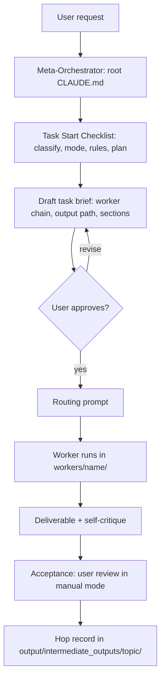

# claude_agents

A Claude Code harness for knowledge work (research briefs, technology and vendor comparisons, presentations, code written from library docs) that keeps output grounded in fetched sources rather than training data. A root `CLAUDE.md` makes the main session a Meta-Orchestrator: it classifies each task, drafts a task brief for human approval and routes it to one of five single-mandate workers, backed by three local MCP servers. Workers fetch only approved sources, report what they could not fetch, and end each deliverable with a self-critique that lists unsupported claims. The aim is to make ungrounded claims visible, not to prevent them; the operator stays the main safeguard. Grounding is an instruction to the model; writes to protected repo paths and worker Bash are enforced by settings, and the fetch cap by code for sessions launched with one. To measure whether it beats a plain Claude session, the repo includes a blinded baseline-eval protocol: the same task runs through the harness and through plain Claude, and the owner scores both outputs without knowing which is which. No result is stated for a worker until it has 5 evals ([`workers/BASELINE_EVAL_PROTOCOL.md`](workers/BASELINE_EVAL_PROTOCOL.md)).

## How it works

| Worker | Directory | Does | Tools |
|---|---|---|---|
| Developer | `workers/developer/` | Grounded code, sandbox scripts, ML tasks, system checks, technical docs | `docs_fetcher`, `system_monitor` |
| Architect | `workers/architect/` | Technology selection, architecture proposals, tradeoffs; no code | `docs_fetcher` |
| Content | `workers/content/` | Research-grounded written deliverables and document review; no code, no technical docs | `docs_fetcher` |
| Researcher | `workers/researcher/` | Pre-task planning docs, and research reports from owner-approved sources (report mode); no code, no architecture | `docs_fetcher` |
| Scout | `workers/scout/` | Source discovery by web search for owner approval; no fetching, no findings | `web_search` |

## What this demonstrates

- **Orchestrator and worker rule design.** One routing session that writes no application code (`CLAUDE.md`); a shared security baseline and hand-off rule every worker reads (`workers/WORKER_STANDARDS.md`, `workers/*_PROTOCOL.md`); one short rule file per mandate (`workers/{developer,architect,content,researcher,scout}/CLAUDE.md`).
- **Three MCP servers.** `servers/docs_fetcher/` (11 tools: source registries, fetch, search, crawl, stats, with a fetch cap for sessions launched with `DOCS_FETCHER_MAX_URLS`), `servers/system_monitor/` (5 read-only tools plus 2 SessionStart hook scripts), `servers/web_search/` (1 read-only Brave Search tool, scout only); all pinned with `uv.lock` and `fastmcp>=3.2.0,<4`.
- **Write denies and sandboxed Bash.** Per-worker settings templates deny writes to protected repo paths and sandbox Bash for the four workers that have it (`workers/*/.claude/settings.local.template.json`, verified live 2026-11-07).
- **Agent SDK coordinator.** Hop sequencing, a 3-part acceptance check (file exists, required sections, self-critique present), a read-only Validator and human gates (`coordinator/`).
- **Test suite and CI.** One command runs six offline suites, each in its own `uv` environment (`scripts/run_tests.py`); a workflow runs it on push and pull request (`.github/workflows/tests.yml`); template tests check that config templates parse and agree with the Workers table (`tests/test_templates.py`).
- **Grounding and import checkers.** A grounding quote checker (`scripts/check_grounding.py`) and an import-versus-kb checker (`scripts/check_imports.py`), run by hand at acceptance.

## Evidence

From "Proven (evidence)" in [`STATUS.md`](STATUS.md), last reviewed 2026-11-20. A dash means the row carries no date there.

| Claim | Evidence | Date |
|---|---|---|
| The three MCP servers exist with the tools named in the docs | `servers/*/server.py` (11, 5 and 1 tools) | — |
| Servers are reproducibly pinned | `servers/*/uv.lock`, `servers/*/pyproject.toml` | — |
| A coordinator exists with an automated acceptance check and a read-only Validator | `coordinator/acceptance.py`, `coordinator/orchestrator.py`, `coordinator/worker_registry.py` | — |
| Coordinator mode is available per task but lightly proven: 270 offline tests; 2 opt-in live tests passed once; three live single-hop Developer runs on internal tasks (two accepted, one wrongly failed by a path-base defect, since fixed); one live single-hop Scout run; the blocked-fetch resume has not run live | `workers/MODE_SELECTION_PROTOCOL.md`, `coordinator/tests/` | Override lifted 2026-11-09; Developer runs 2026-11-12; Scout run 2026-11-13; live tests 2026-11-20 |
| All five pipeline phase files exist and define their outputs | `pipeline/phases/01_research.md` to `05_publicize.md` | — |
| A checker can verify a pipeline run's artifacts, ordering and the human gate | `scripts/check_pipeline_run.py` | — |
| Five workers are defined | `workers/*/CLAUDE.md` | — |
| Runtime state is excluded from version control; templates are tracked | `.gitignore`, `*_TEMPLATE.*`, `*.template.json` | — |
| Build-out history: 151 commits | `git rev-list --count 5b5d3fe` (e4f93d5 to 5b5d3fe; a snapshot) | 2026-03-30 to 2026-11-20 |
| `docs_fetcher` has offline tests | 174 passed, `servers/docs_fetcher/tests/` | — |
| All six maintenance scripts have offline tests; servers, hooks, config templates and coordinator are covered by 929 passing tests | `scripts/tests/`, `servers/*/tests/`, `tests/`, `coordinator/tests/`, `scripts/run_tests.py` | Run 2026-11-20 |
| Write denies and sandboxed Bash blocked test writes from the worker folders | Owner's Track-record entries | 2026-11-07 |
| Fetch cap refuses over-budget fetches | Owner-run live check, Track-record entry | 2026-11-07 |
| Owner-reported, sanitized task outcomes | Owner's local Track-record log (not tracked) | — |

What is not shown, including success rates, cost per task and any end-to-end pipeline run: "Not yet evidenced" in [`STATUS.md`](STATUS.md).

## Repo map

- `.claude/`: settings templates for the root session (hooks, enabled servers).
- `.github/`: CI workflow and pull request template.
- `coordinator/`: Agent SDK coordinator, its README and offline tests.
- `logs/`: blank templates of the gitignored runtime logs, plus the ephemeral task-log protocol.
- `output/`: placeholder folders for gitignored deliverables, plus an archive template.
- `pipeline/`: five-phase pipeline spec and phase files; built but unused.
- `scripts/`: maintenance checks, the import and grounding checkers, the test runner and their tests.
- `servers/`: the three MCP servers, their tests and the tool-building loop.
- `tests/`: config-template tests.
- `workers/`: shared worker standards, protocols and the five worker folders.

## Getting started

Setup, operating modes, current state, the build-out timeline and design rationale are in [`docs/OPERATOR_GUIDE.md`](docs/OPERATOR_GUIDE.md).

## Credits

5-phase pipeline contributed by Bao Nguyen (@BaoTNguyen) (f203d78, e1d54b4, cb9688b).

## Author

Built by Magnus Lanoil · [LinkedIn](https://www.linkedin.com/in/magnus-lanoil/)
